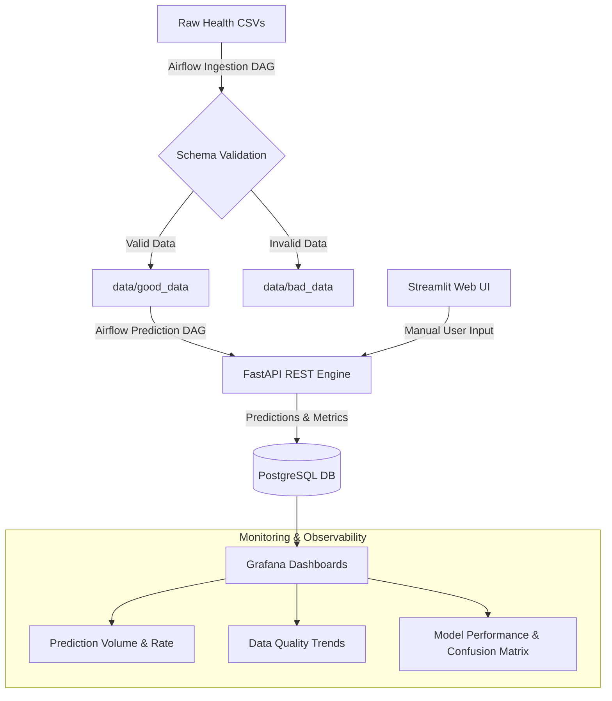

#  HealthVision – End-to-End Production Diabetes Prediction Platform


An end-to-end, production-grade machine learning system for predicting diabetes risk based on patient health indicators (Pima Indians Diabetes Dataset). Built with automated Airflow ingestion pipelines, schema validation, real-time REST inference, interactive UI, SQL prediction logging, and live Grafana monitoring.

Developed as part of the **Data Science in Production** curriculum at EPITA.

---

##  Project Team

* **Basit Ur Rehman**
* **Juan Sebastian Pereira Lopez**
* **Iqra Javed**
* **Kaviyarasan Arul Jothi**


---

##  Pipeline & System Architecture



##  Key Features & Engineering Highlights

* **Automated Data Quality & Ingestion (Apache Airflow):**
  * **`data_ingestion_pipeline` DAG:** Processes incoming CSVs from `data/raw_data/`, validates schema and value constraints, and routes files to `good_data/` or `bad_data/` while storing file-level quality statistics in PostgreSQL.
  * **`process_success_files_dag` DAG:** Detects newly validated files, triggers scheduled batch predictions via the API, and persists results to PostgreSQL.
* **REST API & Web Application:**
  * **FastAPI Backend:** Exposes prediction endpoints (`/predict`) and logs inputs, predictions, and sources (`webapp` vs. `scheduled`) to the database.
  * **Streamlit UI:** Interactive web interface for medical practitioners to input patient records and receive instant risk predictions.
* **Production Observability (Grafana):**
  * Live monitoring of prediction distributions, data validation error rates, and ground-truth model performance (Confusion Matrix, False Positives/Negatives, Accuracy over time).
* **Operational Service Manager (`manage.sh`):**
  * Custom bash manager script coordinating startup/shutdown of Docker services, FastAPI, Streamlit, and Airflow processes while handling port conflicts.

---

##  Technology Stack

| Layer | Technology |
| :--- | :--- |
| **User Interface** | Streamlit |
| **API Backend** | FastAPI, Uvicorn, Pydantic |
| **Machine Learning** | Scikit-Learn (Clinical Logistic/Tree Classifier) |
| **Database** | PostgreSQL 14, pgAdmin |
| **Orchestration** | Apache Airflow 2.x |
| **Monitoring** | Grafana |
| **Infrastructure** | Docker, Docker Compose, Bash (`manage.sh`) |

---

##  Project Structure

```text
DSP-FINAL-PROJECT/
├── api/                    # FastAPI backend server
├── webapp/                 # Streamlit user interface
├── airflow/                # Airflow home & DAG definitions
│   └── dags/
│       ├── data_ingestion_pipeline.py
│       └── process_success_files_dag.py
├── data/                   # Data processing directories
│   ├── raw_data/           # Incoming CSV uploads
│   ├── good_data/          # Schema-validated CSVs
│   └── bad_data/           # Invalid/corrupted CSV dumps
├── db/                     # Master SQL schema scripts
├── grafana/                # Grafana dashboards & provisioning
├── docker-compose.yaml     # Infrastructure: Postgres, pgAdmin, Grafana
├── manage.sh               # Service management script
└── README.md
```
##  Quick Start & Operating Instructions

>  Always manage services using `./manage.sh` to ensure clean process execution and avoid port conflicts.

### Prerequisites
* Docker Desktop installed with WSL integration enabled.
* Python 3.12 virtual environment at `.venv/`.

### Service Management Commands

```bash
# Make script executable
chmod +x manage.sh

# Start all services (Docker, FastAPI, Streamlit, Airflow)
./manage.sh start

# Check running process status
./manage.sh status

# Stop all running services
./manage.sh stop

# Clean restart
./manage.sh restart

```
##  Application Endpoints

| Service | Access URL | Description |
| :--- | :--- | :--- |
| **FastAPI Docs** | `http://localhost:8000/docs` | Interactive Swagger API documentation |
| **Streamlit UI** | `http://localhost:8501` | Patient prediction web interface |
| **Airflow UI** | `http://localhost:8080` | Pipeline orchestration & DAG execution |
| **Grafana** | `http://localhost:3000` | Production metrics dashboard |
| **pgAdmin** | `http://localhost:5051` | Database UI manager |
| **PostgreSQL** | `localhost:5432` | Primary SQL storage engine |

---

##  Database Schema Summary

* **`diabetes_data`:** Stores feature inputs, predicted outcomes (`0`/`1`), ground-truth values (when available), request source, and timestamp.
* **`file_statistics`:** Tracks ingested files, total rows, valid/invalid row counts, and validation error messages.

---

##  Service Logs

All execution logs are recorded under `./logs/`. Track real-time activity using `tail`:

```bash
tail -f logs/api.log
tail -f logs/streamlit.log
tail -f logs/airflow_webserver.log

```
